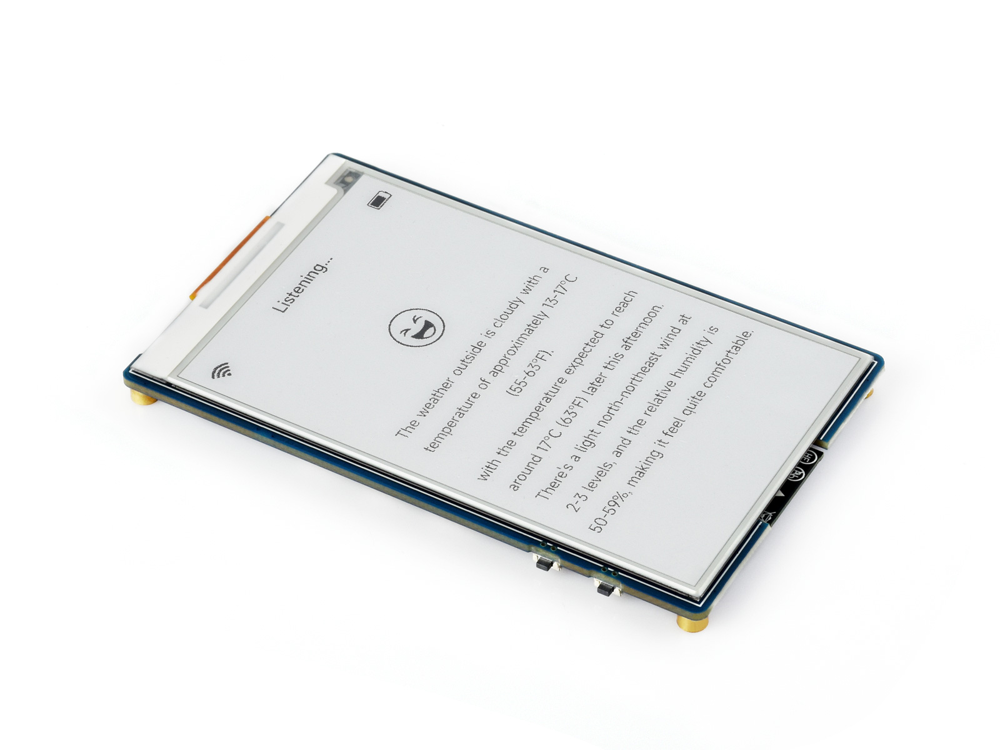
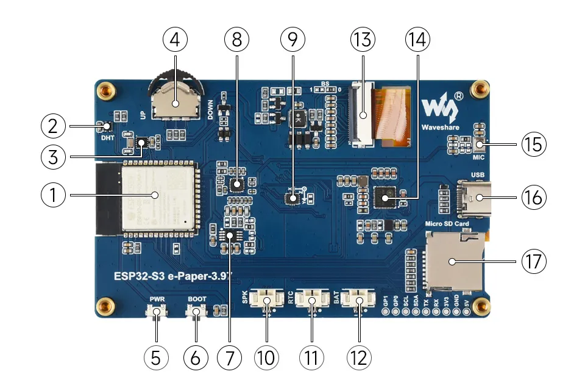
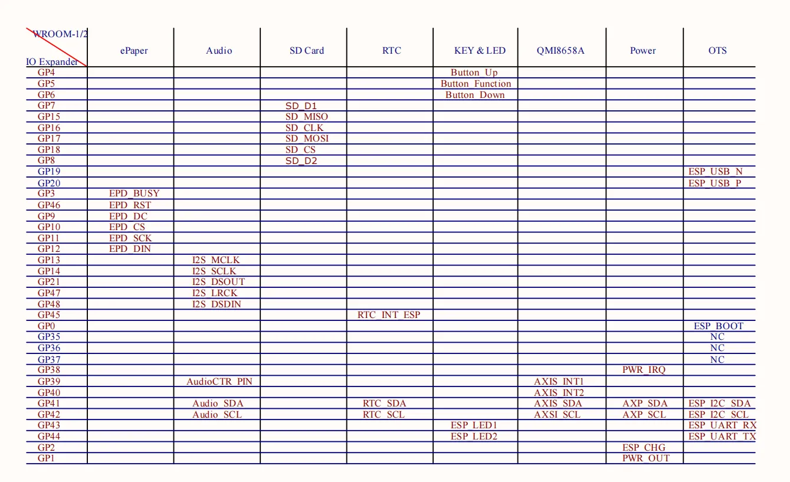
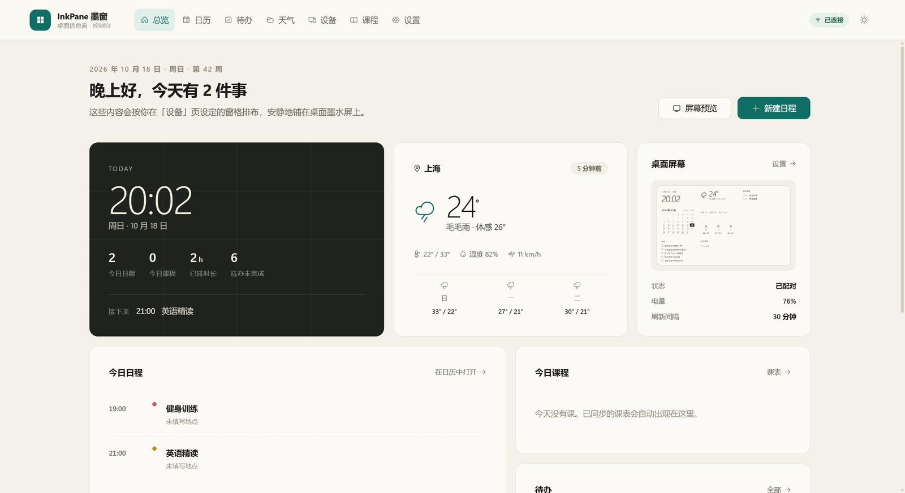
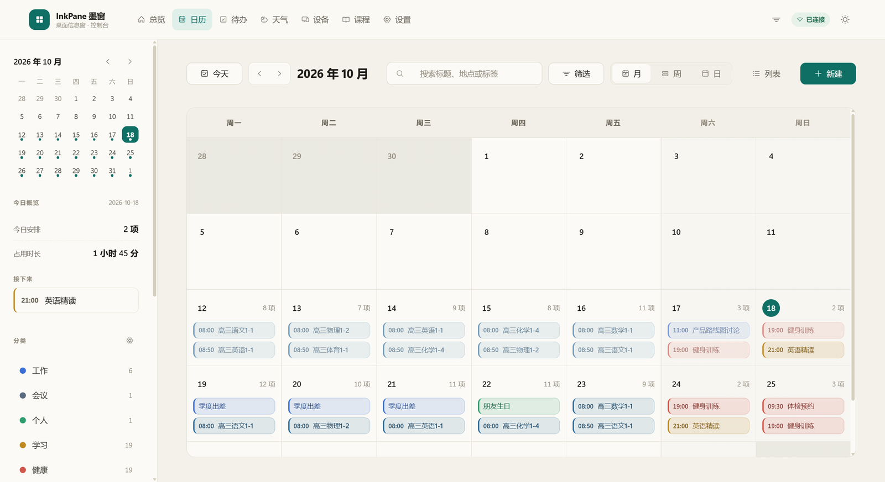
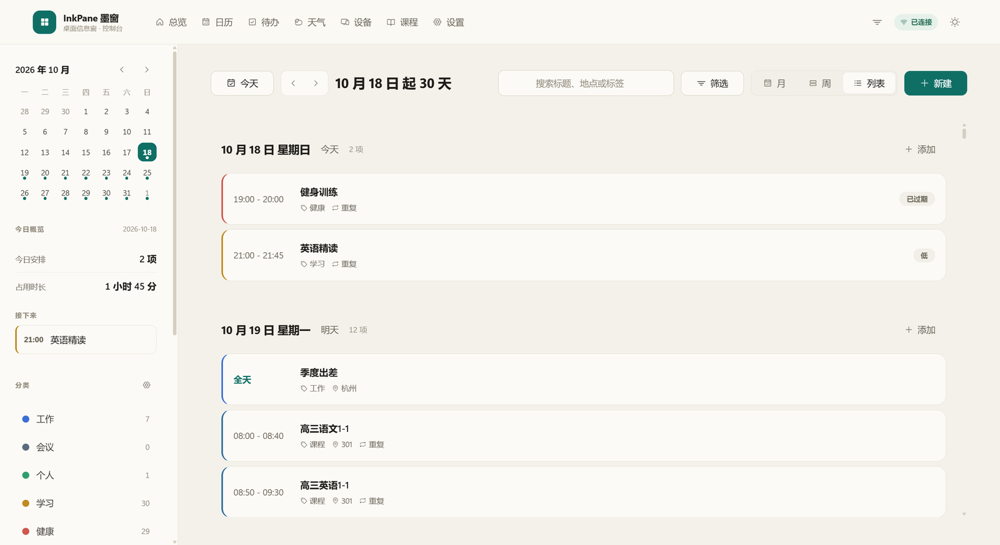
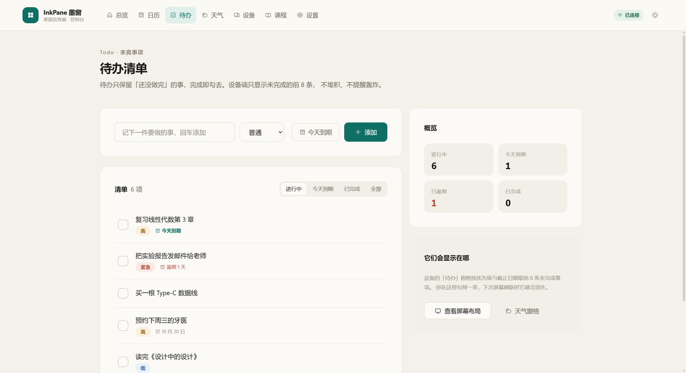
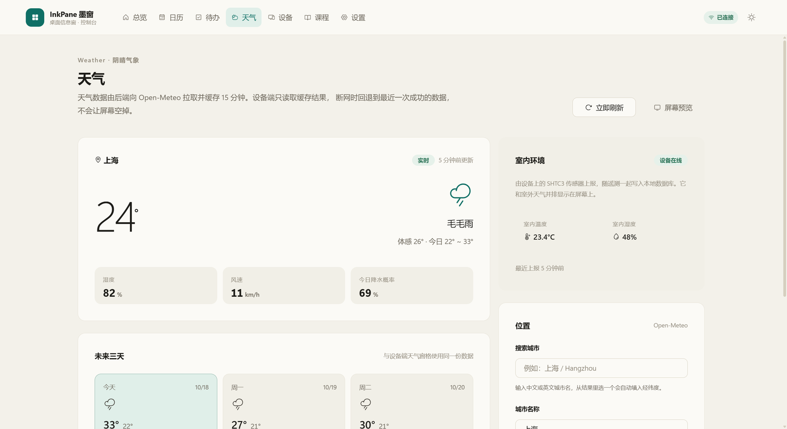
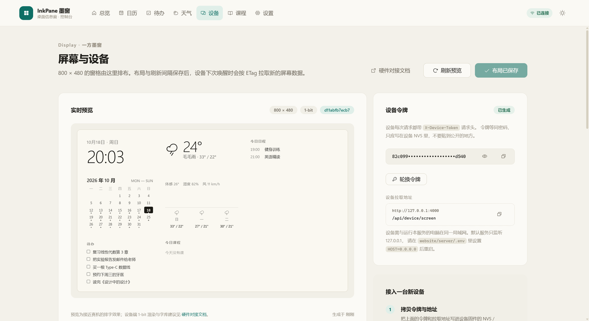

<p align="center">
  
</p>

<h1 align="center">InkPane · 墨窗</h1>

<p align="center">
  <strong>一窗墨色，一日清明。</strong><br>
  <sub>One pane of ink — a day made clear.</sub>
</p>

<p align="center">
  <sub>ESP32-S3 · 3.97″ 电子墨水 · 800 × 480 · 桌面常显 · 超低功耗</sub>
</p>

---

> 于方寸桌面，辟一窗静境。
> 窗内收纳时序流转、阴晴气象，排布课业日程，罗列未竟事项。

InkPane 墨窗，以电子墨水为纸，以规整窗格为形，将整日行程从容铺展于桌面。
无背光、无频闪、无信息侵扰；不抢夺视线，不制造光污染，唯有目光落处，信息清晰浮现。

**Ink**，是墨色纸屏的沉静；**Pane**，是信息之窗的通透。
墨窗，是书桌之上的一方静谧窗口，亦是人与日常之间温和克制的交互界面。

*A quiet pane of electronic ink for your desk — time, weather, classes and to-dos, always in view, never in the way.*

---

## 核心能力

整合时间日历、实时天气、课程日程与待办清单，共六个可独立开关的窗格；外加一个常驻语音助手，
可以直接用说的新增/取消日程、加待办、查今天安排，识别与回复文本落在同一块墨水屏上。

| 窗格 | 内容 |
| --- | --- |
| **时钟** | 大字时间、星期与日期，跨天自动换日 |
| **月历** | 当月月历，并标记有日程的日期 |
| **天气** | 室外温度、体感与阴晴趋势；机身板载温湿度传感器，室内读数本地直采 |
| **日程** | 当日时间线，按开始时间排列 |
| **课程** | 当日课表、上课时间与地点；整学期课表可导入并定时自动同步 |
| **待办** | 未竟事项按手动排序罗列，完成即勾去，不堆积、不轰炸 |
| **语音助手** | 常驻唤醒词与小智对话；可直接新增/取消日程、新增/完成待办、查询今天安排，识别与回复文本落在墨水屏上 |

六个窗格可分别开关，并可用四套预设（均衡 / 日程优先 / 天气优先 / 极简）一键切换布局；
布局保存在账号下，同一账号绑定的多台设备共用。
你看到的永远是「此刻需要的那一屏」，而不是又一个需要照顾的信息源。

## 语音助手

墨窗默认以**常驻模式**运行：Wi-Fi 与麦克风常开，唤醒词随时可用；看板仍按刷新间隔拉屏、
每分钟局刷时钟。语音栈参考 [xiaozhi-esp32](https://github.com/78/xiaozhi-esp32)（MIT），
设备通过小智 WebSocket 协议连接语音服务，并把「新增日程 / 完成待办 / 查询今天」等能力
用 MCP 工具接回 InkPane 控制台。

- **首次使用**：配网 → 控制台启用语音 → 设备屏幕显示 6 位激活码 → 到 `xiaozhi.me` 输入绑定；
  设备会先校准时间再访问 HTTPS OTA。OTA 地址可在控制台或配网页修改，默认官方云，也支持自建
  `xiaozhi-esp32-server`。
- **自定义唤醒词**：控制台/配网页填写，1–8 条、每条 2–12 个汉字；运行时重配 ESP-SR MultiNet
  命令词，无需重新编译。受模型词表限制，逐词识别率需真机验收。
- **语音控制**：说「明天下午三点开会」「加一个待办：周五前交报告」「今天有什么安排」
  「把那个待办标记完成」「刷新屏幕」「音量调到 40」。控制台「允许语音修改日程与待办」关闭后，
  设备只注册只读工具。
- **按键**：唤醒词开始对话；BOOT 短按=按住说话/停止/打断；长按 3 秒=唤醒词静音；
  滚轮 4/6/5 仍是看板的模块放大与总览切换。
- **隐私**：唤醒前后音频不上传、不落盘；不需要语音时可在控制台关闭，或长按 BOOT 静音。
- **功耗**：常驻监听预计 100–200 mA，建议 USB 供电；电池长待机可切到 `LOW_POWER` 模式编译回
  原「每分钟唤醒 + 深睡」看板（语音不初始化）。

完整配置、限制、排障与真机验收清单见 **[hardware/docs/VOICE.md](hardware/docs/VOICE.md)**。

## 产品理念

- **纸本观感** —— 墨色文字落在哑光纸面上，对比度来自环境光，而非背光。
- **极简窗格** —— 以规整栅格组织信息，留白也是内容的一部分；没有动画争夺注意力。
- **护眼常显** —— 无背光、无频闪，画面静止时不耗电，久看不累，也不需要「息屏」。
- **双模式功耗** —— 纯看板可回到「只在内容变化时刷新、其余时间深睡」；需要语音时保持常驻，
  用 USB 供电换随时可唤醒。
- **不打扰** —— 没有推送、没有红点、没有广告位。信息安静地待在那里，等你看它。

## 适用场景

| 场景 | 说明 |
| --- | --- |
| **学生书桌** | 课表、作业与倒计时就摆在台灯旁边，抬眼即知下一节课在哪间教室 |
| **职场办公桌** | 日程、会议与待办常显，不必反复点亮手机或切换窗口 |
| **卧室床头柜** | 时间与天气一眼可读，临睡前不必再面对发光屏幕 |
| **家庭信息角** | 全家的日程与备忘并列一屏，纸质便签的秩序感，电子化的即时性 |

## 硬件平台

墨窗运行在 **微雪 ESP32-S3-ePaper-3.97** 开发板上：一块 3.97 英寸、800 × 480 的电子墨水屏，
配上 ESP32-S3 的双核算力与 Wi-Fi / BLE 连接，以及一套刚好够用的传感器与电源管理。

<p align="center">
  
</p>
<p align="center"><sub>板载资源（编号对应微雪官方文档）</sub></p>

| 项目 | 规格 |
| --- | --- |
| 主控 | ESP32-S3R8，Xtensa<sup>®</sup> 32 位 LX7 双核，最高 240 MHz |
| 内存 / 存储 | 512 KB SRAM + 384 KB ROM，叠封 8 MB PSRAM；16 MB Flash，另带 Micro SD 卡槽（FAT32） |
| 无线 | 2.4 GHz Wi-Fi（802.11 b/g/n）+ Bluetooth 5 (LE)，板载天线 |
| 屏幕 | 3.97 英寸电子墨水屏，800 × 480，高对比度、宽视角 |
| 传感 | SHTC3 温湿度传感器 · QMI8658 六轴 IMU · PCF85063 RTC 实时时钟 |
| 音频 | ES8311 低功耗音频编解码 + NS4150B 功放，板载麦克风与喇叭接口 |
| 电源 | AXP2101 电源管理，3.7 V MX1.25 锂电池供电并支持充放电，另留 RTC 备用电池接口 |
| 交互 | 拨轮按键（三向）+ BOOT + PWR 侧键，可自定义按键功能 |
| 接口 | USB Type-C，用于烧录与日志输出 |

<p align="center">
  
</p>
<p align="center"><sub>板载接口与连接器</sub></p>

硬件资料、原理图与示例固件见微雪官方文档：
[ESP32-S3-ePaper-3.97](https://docs.waveshare.net/ESP32-S3-ePaper-3.97/) ·
[相关资料](https://docs.waveshare.net/ESP32-S3-ePaper-3.97/Resources-And-Documents) ·
[产品页](https://www.waveshare.net/shop/ESP32-S3-ePaper-3.97.htm)

## 配套控制台

墨水屏打字不便，所以墨窗把「录入与整理」交给桌面端控制台：日程、课程、待办、天气与屏幕布局
都在这里调整，设备端只负责把整理好的内容，以最安静的方式铺到屏幕上。

<p align="center">
  
</p>
<p align="center"><sub>总览：今日日程、天气、待办与桌面屏幕的实时缩略预览</sub></p>

- **总览** —— 一屏看完今天：日程、课程、待办、天气与设备状态，并实时预览设备上的那一屏。
- **待办清单** —— 优先级、截止日期、完成即勾去；设备端只取未完成的前 8 条，不堆积、不轰炸。
- **天气** —— 当前实况、未来三天、城市搜索与经纬度手填；失败自动回退缓存，不让屏幕空掉。
- **屏幕与设备** —— 多设备管理、一次性令牌、在线状态与遥测；六模块开关、四套布局预设、刷新间隔与显示时区，800 × 480 实时预览。
- **语音助手** —— 启用开关、允许语音修改日程/待办、小智 OTA 地址、自定义唤醒词（1–8 条中文）、灵敏度与音量；设置随屏幕数据下发，设备无需重新烧录。
- **账户与权限** —— 首次启动创建管理员，之后由管理员建号；会话 Cookie + scrypt 密码，所有数据按账号隔离。
- **日历** —— 月 / 周 / 日 / 列表四种视图；拖拽即改期、重复日程、分类标签、提醒与课程同步。
- **主题与键盘** —— 深色 / 浅色 / 跟随系统，首屏不闪白；`T` 今天、`M/W/D` 视图、`N` 新建、`/` 搜索。

<p align="center">
  
  
</p>
<p align="center"><sub>月视图与列表视图</sub></p>

<p align="center">
  
  
</p>
<p align="center"><sub>待办清单与天气</sub></p>

<p align="center">
  
</p>
<p align="center"><sub>屏幕与设备：布局编辑、实时预览、令牌与遥测</sub></p>

**数据留在本机。** 账号、日程、待办、天气缓存与设备令牌都存于本地 SQLite，不依赖任何云服务；
课程密码以 AES-256-GCM 密文保存，接口永不回传明文。

技术栈与工程细节（分层设计、重复日程引擎、时区处理、测试与静态检查）见
[website/README.md](website/README.md)。

## 硬件对接

设备端与本地服务之间是一套稳定、可离线重试的 HTTP 契约，完整说明见
**[设备端 API 与硬件对接指南](website/docs/DEVICE-API.md)**（含数据契约、1-bit 渲染规范、
低功耗策略、ESP-IDF 示例与 curl 调试步骤）。

```text
设备唤醒 ──► GET /api/device/screen（带 X-Device-Token + If-None-Match）
              │  304 ──► 内容未变，不重绘，直接休眠
              │  200 ──► 按 screen.layout 渲染 800×480 窗格
              ├──► POST /api/device/telemetry 上报 SHTC3 温湿度与电量
              └──► 按 refreshMinutes 深度休眠，RTC 定时唤醒
```

| 接口 | 说明 |
| --- | --- |
| `GET /api/device/screen` | 屏幕数据：布局、时钟、月历、天气、今日日程 / 课程 / 待办、语音配置；带 ETag，内容未变返回 304 |
| `POST /api/device/telemetry` | 上报温度、湿度、电量、信号、固件版本与运行时长 |
| `GET /api/device/context` | 语音助手读写前的今日上下文（当前时间、时区、今日日程 / 课程 / 未完成待办） |
| `POST/PATCH/DELETE /api/device/events`、`/api/device/todos` | 语音 MCP 工具调用：新增/修改/删除日程与待办（设备令牌鉴权、按设备限流） |
| `GET /api/display`、`PUT /api/display` | 读取 / 保存 6 个模块的窗格、刷新间隔与显示时区 |
| `GET /api/voice`、`PUT /api/voice` | 读取 / 保存语音开关、允许修改、OTA 地址、自定义唤醒词、灵敏度与音量 |
| `GET/POST /api/devices`、`POST /api/devices/:id/rotate` | 管理当前账号的设备与令牌（完整令牌只在创建/轮换时返回一次） |

设备令牌在控制台「屏幕与设备」页创建设备时获取一次；默认服务只监听 `127.0.0.1`，设备接入时需在
`website/server/.env` 中设置 `HOST=0.0.0.0` 后重启。

> 语音对话本身走独立的小智服务（`OTA 地址` 可配置），不经过 InkPane 控制台；控制台只负责
> 下发语音设置、接收 MCP 写请求并落库。设备第一次激活需要在 `xiaozhi.me` 绑定设备。

## 目录结构

```text
InkPane/
├── README.md               # 你正在读的这个文件
├── LICENSE
├── assets/images/          # 产品图与硬件资源图
├── hardware/               # 设备端固件与硬件资料（MVP 已实现，待真机验收）
└── website/                # InkPane 控制台
    ├── server/             # Express + node:sqlite，REST API
    ├── web/                # React 18 + TypeScript + Vite
    ├── docs/               # 架构说明、REST API、设备对接文档、界面截图
    └── scripts/            # 工程脚本
```

## 快速开始

**运行控制台**（需要 Node.js >= 22.13，使用内置 `node:sqlite`，无需任何原生编译依赖）：

```bash
cd website
npm install          # 安装前后端全部依赖（npm workspaces）
npm run dev          # 仅本机：API（127.0.0.1:4000）+ 前端（5173）
npm run dev:lan      # 要接设备/手机时用：API 监听 0.0.0.0:4000，前端也监听局域网
```

打开 <http://localhost:5173> 后进入 **`/setup`** 创建第一个管理员；初始化完成后会写入一批演示日程，
界面不会是空的。之后由管理员在「用户管理」里创建其他账号。若服务监听在局域网地址，初始化还会要求
服务端启动日志里打印的一次性初始化码（可用 `INKPANE_SETUP_CODE` 固定）。

| 命令 | 作用 |
| --- | --- |
| `npm run dev` | 并行启动前后端（开发模式，热更新，仅本机可访问） |
| `npm run dev:lan` | 局域网模式：`HOST=0.0.0.0`，设备与手机可以访问（接硬件时用这个） |
| `npm run verify` | lint + 类型检查 + 测试 + 生产构建，提交前跑一遍 |
| `npm test` | 前后端单元测试与接口集成测试 |
| `npm run build` | 构建前端产物与后端 JS |
| `npm start` | 以生产模式启动后端（设置 `SERVE_STATIC=true` 可同时托管前端） |
| `npm start:lan` | 生产模式的局域网版本（先 `npm run build`） |

数据默认落在 `website/data/inkpane.sqlite`，运行期配置见 `website/server/.env.example`。

**接入设备**：先完成 `/setup` 并登录，打开控制台「屏幕与设备」页添加设备——完整令牌只显示一次，
之后可随时轮换。设备地址与字段、错误码见 [设备端 API 与硬件对接指南](website/docs/DEVICE-API.md)。
设备与电脑在同一局域网时，用 `npm run dev:lan` 启动（等价于在 `website/server/.env` 里设 `HOST=0.0.0.0`）；
启动日志会打印「设备端可填写：`http://<本机局域网 IP>:4000`」，配网时原样填入这个地址
（不要带 `/api`，结尾不要带 `/`）。Windows 首次监听时如弹出防火墙提示，请允许「专用网络」。

**点亮屏幕**：设备端固件位于 [`hardware/`](hardware/README.md)，是一个 ESP-IDF **v6.0.2** 工程，
已实现六模块 1-bit 渲染、ETag / 304、AP 配网、双周期深睡，以及常驻语音助手（小智协议、
自定义唤醒词、MCP 语音控制）；语音相关配置与真机验收见
[hardware/docs/VOICE.md](hardware/docs/VOICE.md)。构建、烧录与配网步骤见该目录 README。

### 设备连不上控制台（屏幕停在「等待校时」）

设备日志里出现 `select() timeout` / `ESP_ERR_HTTP_CONNECT`，说明 TCP 连接根本没建立。按顺序排查：

| 现象 | 原因 | 处理 |
| --- | --- | --- |
| 服务启动日志出现「当前只监听回环地址…」 | 服务只监听 `127.0.0.1`，局域网设备连不进来 | 用 `npm run dev:lan` 重启，或在 `website/server/.env` 设 `HOST=0.0.0.0` |
| 改了 `HOST` 仍然超时 | Windows 防火墙拦截入站 TCP 4000 | 「允许应用通过防火墙」里放行 Node.js（专用网络），或手动放行 TCP 4000 |
| 手机能打开、设备不行 | 两者不在同一网段，或路由器开了无线隔离/访客网络 | 关闭 AP 隔离，或把设备与电脑连到同一 SSID |
| 设备日志 401 / 屏幕提示「设备令牌无效」 | 令牌已轮换或填错 | 控制台「屏幕与设备」重新获取令牌，长按中键开机重新配网 |

最快的验证方式：用手机浏览器打开启动日志里的
`http://<本机局域网 IP>:4000/api/health`，能返回 `{"data":{"status":"ok",...}}` 就说明网络和
防火墙都通，剩下的只需把这个地址填进设备配网页。设备失败后会先显示整屏提示页
（包含本机 IP、服务地址与重试提示），失败后按 60 秒、120 秒…退避（上限 10 分钟），
也可按任意键立即重试。


## 项目状态

- [x] 产品定义、视觉规范与控制台信息架构
- [x] 控制台：总览、日历、待办、天气、屏幕布局编辑与课程同步
- [x] 控制台 v4：多用户 / 登录鉴权 / 多设备管理，数据按账号隔离
- [x] 设备对接协议：屏幕数据、ETag / 304、遥测、一次性令牌与完整硬件对接文档
- [x] 硬件平台选型：ESP32-S3-ePaper-3.97
- [x] 设备端固件 MVP：六模块 1-bit 渲染、AP 配网、双周期深睡（ESP-IDF v6.0.2 构建通过）
- [x] 设备端按键放大：滚轮切模块 / 中键放大↔总览，RTC 快照离线渲染
- [x] 常驻语音助手：小智 OTA/激活、ESP-SR MultiNet 自定义唤醒词、会话与墨水屏语音页（构建通过）
- [x] 语音控制：MCP 工具 + 控制台设备写接口，语音新增/完成/删除日程与待办、查询今天、刷新屏幕
- [x] 控制台语音设置：启用/允许修改、OTA 地址、唤醒词、灵敏度、音量，随屏幕数据下发
- [ ] 真机验收：刷新时序、残影、深睡电流与低温表现（见 `hardware/docs/ACCEPTANCE.md`）
- [ ] 真机语音验收：音频/唤醒率/激活/TTS/功耗（见 `hardware/docs/VOICE.md` 第 8 节）
- [ ] 屏幕端 1-bit 字库与局刷策略进一步调优

## 参考与致谢

- 硬件参考设计、产品图片与规格数据来自 [微雪电子 ESP32-S3-ePaper-3.97 官方文档](https://docs.waveshare.net/ESP32-S3-ePaper-3.97/)，
  相关版权归深圳市微雪电子有限公司所有。InkPane 是独立项目，与微雪电子无隶属关系。
- 语音音频/协议栈部分源码来自 [xiaozhi-esp32](https://github.com/78/xiaozhi-esp32)（MIT），
  版权声明与改动清单见 `hardware/main/components/inkpane_voice/upstream/`；ESP-SR、Opus、
  ES8311 与 WebSocket 依赖见 [hardware/THIRD_PARTY.md](hardware/THIRD_PARTY.md)。
- 设备对接细节见 [DEVICE-API.md](website/docs/DEVICE-API.md)，REST 接口全集见 [API.md](website/docs/API.md)，
  分层设计见 [ARCHITECTURE.md](website/docs/ARCHITECTURE.md)，语音使用与验收见
  [hardware/docs/VOICE.md](hardware/docs/VOICE.md)。
- 固件开发基于 [ESP-IDF](https://docs.espressif.com/projects/esp-idf/zh_CN/latest/) 与 ESP32-S3 生态。
- 控制台界面图标来自 [Phosphor Icons](https://phosphoricons.com/)，日期处理使用 [date-fns](https://date-fns.org/)。

## 品牌标语

> 一窗墨色，一日清明。

## License

本项目以 [MIT](LICENSE) 许可证开源。
