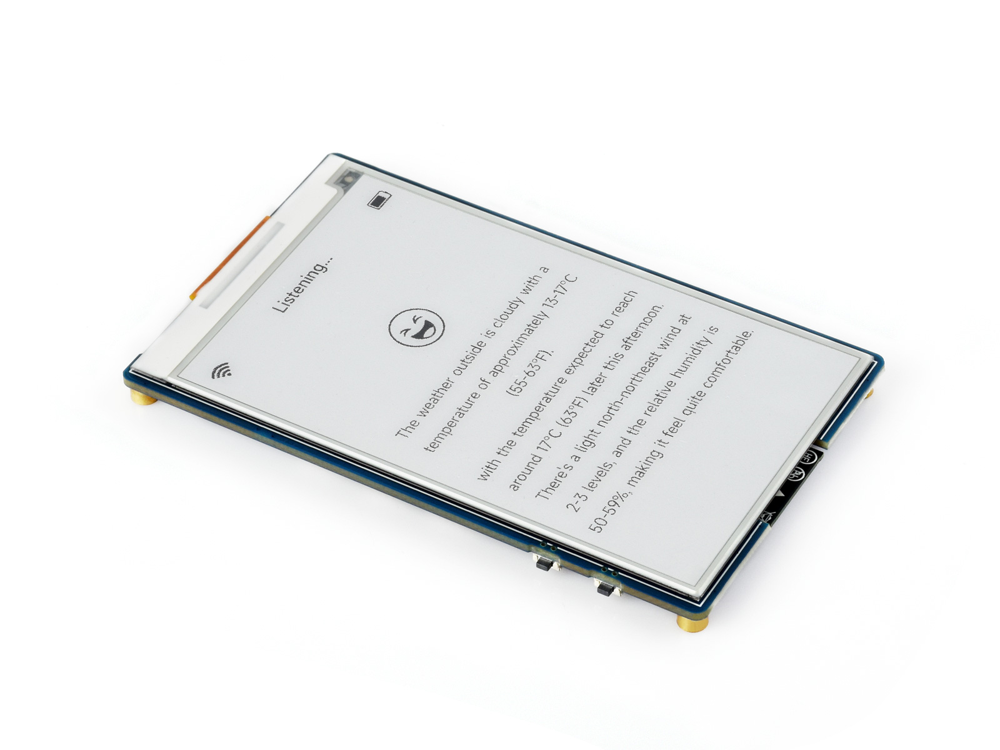
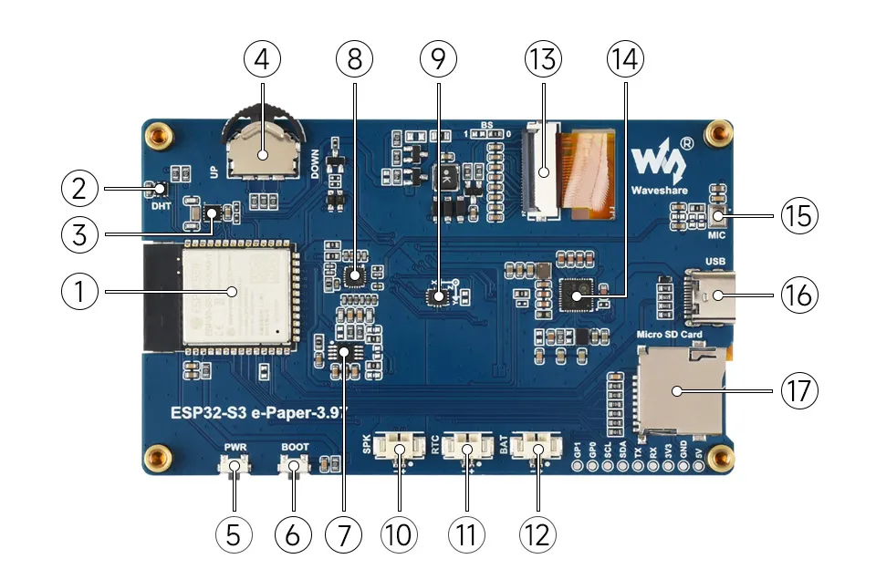
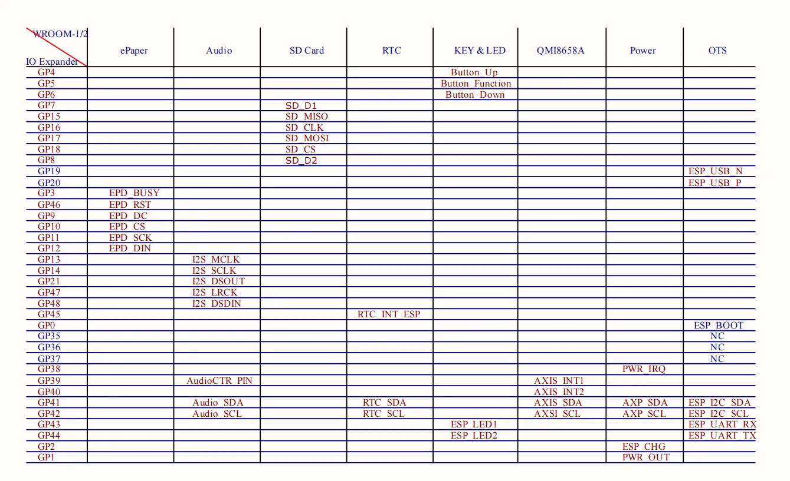
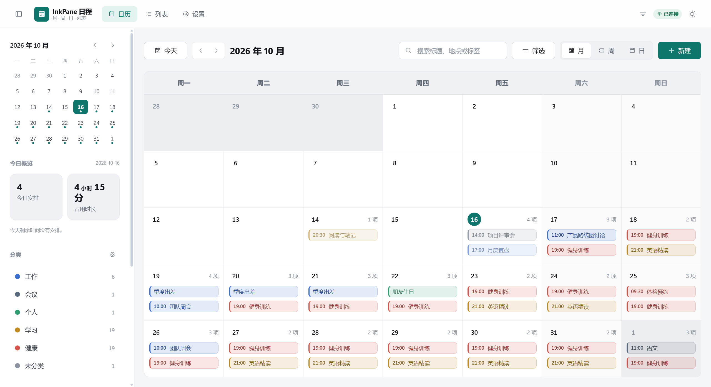
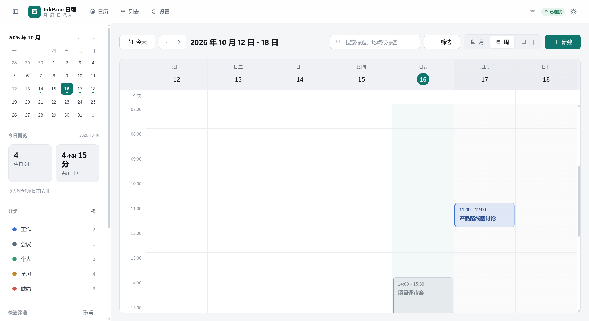
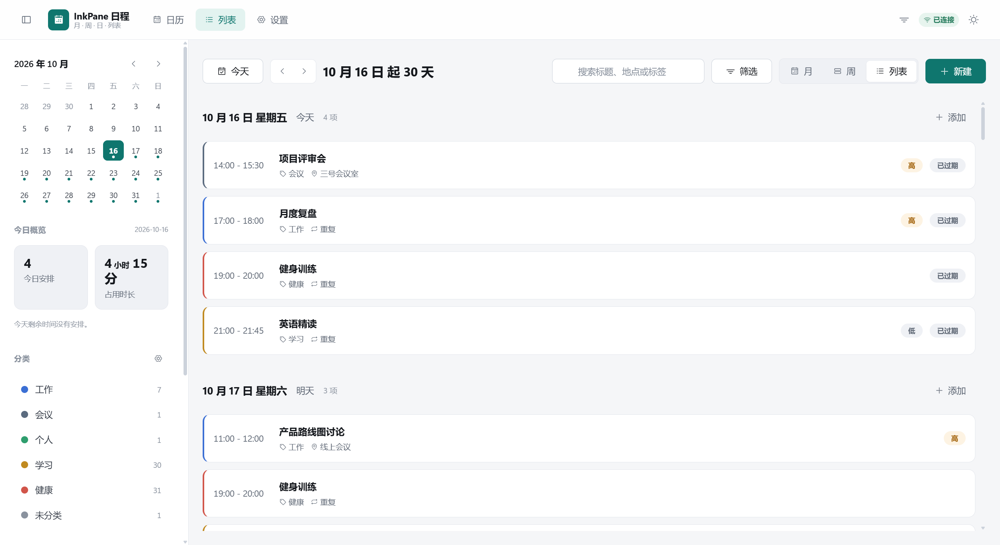
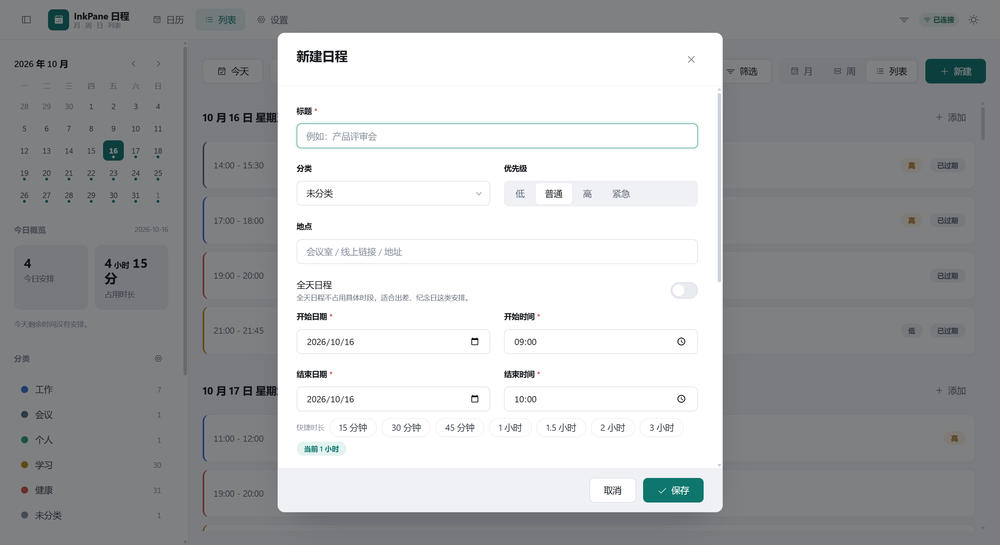

<p align="center">
  
</p>

<h1 align="center">InkPane · 墨窗</h1>

<p align="center">
  <strong>一窗墨色，一日清明。</strong><br>
  <sub>One pane of ink — a day made clear.</sub>
</p>

<p align="center">
  <sub>ESP32-S3 · 3.97″ 电子墨水 · 800 × 480 · 桌面常显 · 超低功耗</sub>
</p>

---

> 于方寸桌面，辟一窗静境。
> 窗内收纳时序流转、阴晴气象，排布课业日程，罗列未竟事项。

InkPane 墨窗，以电子墨水为纸，以规整窗格为形，将整日行程从容铺展于桌面。
无背光、无频闪、无信息侵扰；不抢夺视线，不制造光污染，唯有目光落处，信息清晰浮现。

**Ink**，是墨色纸屏的沉静；**Pane**，是信息之窗的通透。
墨窗，是书桌之上的一方静谧窗口，亦是人与日常之间温和克制的交互界面。

*A quiet pane of electronic ink for your desk — time, weather, classes and to-dos, always in view, never in the way.*

---

## 核心能力

整合时间日历、实时天气、课程日程、待办清单，支持自定义模块自由排布。

| 窗格 | 内容 |
| --- | --- |
| **时间日历** | 今日日期、星期与当月小日历，配合当日时间线，一眼看清「今天走到哪一步」 |
| **实时天气** | 室外温度、体感与阴晴趋势；机身板载温湿度传感器，室内读数本地直采 |
| **课程日程** | 当日课表、上课时间与地点；整学期课表可导入并定时自动同步 |
| **待办清单** | 未竟事项按优先级罗列，完成即勾去，不堆积、不轰炸 |

四块窗格可增删、互换与调整尺寸，排布结果保存在设备上，断电不丢。
你看到的永远是「此刻需要的那一屏」，而不是又一个需要照顾的信息源。

## 产品理念

- **纸本观感** —— 墨色文字落在哑光纸面上，对比度来自环境光，而非背光。
- **极简窗格** —— 以规整栅格组织信息，留白也是内容的一部分；没有动画争夺注意力。
- **护眼常显** —— 无背光、无频闪，画面静止时不耗电，久看不累，也不需要「息屏」。
- **超低功耗** —— 只在内容变化时刷新，其余时间深度休眠，长久待机无电量焦虑。
- **不打扰** —— 没有推送、没有红点、没有广告位。信息安静地待在那里，等你看它。

## 适用场景

| 场景 | 说明 |
| --- | --- |
| **学生书桌** | 课表、作业与倒计时就摆在台灯旁边，抬眼即知下一节课在哪间教室 |
| **职场办公桌** | 日程、会议与待办常显，不必反复点亮手机或切换窗口 |
| **卧室床头柜** | 时间与天气一眼可读，临睡前不必再面对发光屏幕 |
| **家庭信息角** | 全家的日程与备忘并列一屏，纸质便签的秩序感，电子化的即时性 |

## 硬件平台

墨窗运行在 **微雪 ESP32-S3-ePaper-3.97** 开发板上：一块 3.97 英寸、800 × 480 的电子墨水屏，
配上 ESP32-S3 的双核算力与 Wi-Fi / BLE 连接，以及一套刚好够用的传感器与电源管理。

<p align="center">
  
</p>
<p align="center"><sub>板载资源（编号对应微雪官方文档）</sub></p>

| 项目 | 规格 |
| --- | --- |
| 主控 | ESP32-S3R8，Xtensa<sup>®</sup> 32 位 LX7 双核，最高 240 MHz |
| 内存 / 存储 | 512 KB SRAM + 384 KB ROM，叠封 8 MB PSRAM；16 MB Flash，另带 Micro SD 卡槽（FAT32） |
| 无线 | 2.4 GHz Wi-Fi（802.11 b/g/n）+ Bluetooth 5 (LE)，板载天线 |
| 屏幕 | 3.97 英寸电子墨水屏，800 × 480，高对比度、宽视角 |
| 传感 | SHTC3 温湿度传感器 · QMI8658 六轴 IMU · PCF85063 RTC 实时时钟 |
| 音频 | ES8311 低功耗音频编解码 + NS4150B 功放，板载麦克风与喇叭接口 |
| 电源 | TG28 电源管理，3.7 V MX1.25 锂电池供电并支持充放电，另留 RTC 备用电池接口 |
| 交互 | 拨轮按键（三向）+ BOOT + PWR 侧键，可自定义按键功能 |
| 接口 | USB Type-C，用于烧录与日志输出 |

<p align="center">
  
</p>
<p align="center"><sub>板载接口与连接器</sub></p>

硬件资料、原理图与示例固件见微雪官方文档：
[ESP32-S3-ePaper-3.97](https://docs.waveshare.net/ESP32-S3-ePaper-3.97/) ·
[相关资料](https://docs.waveshare.net/ESP32-S3-ePaper-3.97/Resources-And-Documents) ·
[产品页](https://www.waveshare.net/shop/ESP32-S3-ePaper-3.97.htm)

## 配套控制台

墨水屏打字不便，所以墨窗把「录入与整理」交给桌面端控制台：日程、课程、分类与待办在这里编辑，
设备端只负责把整理好的内容，以最安静的方式铺到屏幕上。

<p align="center">
  
</p>
<p align="center"><sub>月视图：今日概览、分类配色与整月事件一览</sub></p>

- **四种视图** —— 月 / 周 / 日 / 列表，适合规划，也适合回顾。
- **拖拽即改期** —— 时间轴空白处拖动新建、拖动事件块改期、拉底边调时长，15 分钟吸附，`Esc` 随时反悔。
- **重复日程** —— 每天 / 每周 / 每月 / 每年，可改单次、改此后所有或拆分序列。
- **分类、标签、搜索筛选** —— 分类带颜色，筛选条件本机持久化。
- **提醒** —— 每 30 秒轮询待触发提醒，走系统通知；未授权时自动降级为页内提示。
- **课程同步** —— 对接学校课程管理系统，支持测试连接、预览课表、立即导入与按配置自动定时同步。
- **主题与键盘** —— 深色 / 浅色 / 跟随系统，首屏不闪白；`T` 今天、`M/W/D` 视图、`N` 新建、`/` 搜索。
- **响应式** —— 桌面端常驻侧栏，移动端抽屉 + 底部标签栏。

**数据留在本机。** 日程与待办存于本地 SQLite，不依赖任何云账号；课程密码以 AES-256-GCM 密文
保存在本机，接口永不回传明文。校方系统本身是 HTTP 明文站点这一限制，也被如实标注在界面里。

<p align="center">
  
  
</p>
<p align="center"><sub>周视图（时间轴自动分列）与列表视图（连续 30 天按天分组）</sub></p>

<p align="center">
  
  
</p>
<p align="center"><sub>新建日程与课程同步</sub></p>

技术栈与工程细节（分层设计、重复日程引擎、时区处理、测试与静态检查）见
[website/README.md](website/README.md)。

## 目录结构

```text
InkPane/
├── README.md               # 你正在读的这个文件
├── LICENSE
├── assets/images/          # 产品图与硬件资源图
├── hardware/               # 设备端固件与硬件资料（开发中）
└── website/                # InkPane 控制台
    ├── server/             # Express + node:sqlite，REST API
    ├── web/                # React 18 + TypeScript + Vite
    ├── docs/               # 架构说明、API 文档、界面截图
    └── scripts/            # 工程脚本
```

## 快速开始

**运行控制台**（需要 Node.js >= 22.5，使用内置 `node:sqlite`，无需任何原生编译依赖）：

```bash
cd website
npm install          # 安装前后端全部依赖（npm workspaces）
npm run dev          # 同时启动 API（:4000）与前端（:5173）
```

打开 <http://localhost:5173> 。首次启动会自动建库、执行迁移并写入一批演示日程，界面不会是空的。

| 命令 | 作用 |
| --- | --- |
| `npm run dev` | 并行启动前后端（开发模式，热更新） |
| `npm run verify` | lint + 类型检查 + 测试 + 生产构建，提交前跑一遍 |
| `npm test` | 前后端单元测试与接口集成测试 |
| `npm run build` | 构建前端产物与后端 JS |
| `npm start` | 以生产模式启动后端（设置 `SERVE_STATIC=true` 可同时托管前端） |

数据默认落在 `website/data/inkpane.sqlite`，运行期配置见 `website/server/.env.example`。

**点亮屏幕**：设备端固件位于 `hardware/`，开发中。当前可先按微雪官方
[ESP-IDF](https://docs.waveshare.net/ESP32-S3-ePaper-3.97/ESP-IDF) /
[Arduino](https://docs.waveshare.net/ESP32-S3-ePaper-3.97/Arduino) 教程跑通屏幕与 Wi-Fi。

## 项目状态

- [x] 产品定义、视觉规范与控制台信息架构
- [x] InkPane 控制台：日程、重复规则、分类标签、提醒、课程同步
- [x] 硬件平台选型：ESP32-S3-ePaper-3.97
- [ ] 墨水屏端渲染与窗格布局引擎
- [ ] 设备与本地服务的数据同步协议
- [ ] 天气模块与休眠 / 局部刷新功耗策略

## 参考与致谢

- 硬件参考设计、产品图片与规格数据来自 [微雪电子 ESP32-S3-ePaper-3.97 官方文档](https://docs.waveshare.net/ESP32-S3-ePaper-3.97/)，
  相关版权归深圳市微雪电子有限公司所有。InkPane 是独立项目，与微雪电子无隶属关系。
- 固件开发基于 [ESP-IDF](https://docs.espressif.com/projects/esp-idf/zh_CN/latest/) 与 ESP32-S3 生态。
- 控制台界面图标来自 [Phosphor Icons](https://phosphoricons.com/)，日期处理使用 [date-fns](https://date-fns.org/)。

## 品牌标语

> 一窗墨色，一日清明。

## License

本项目以 [MIT](LICENSE) 许可证开源。
