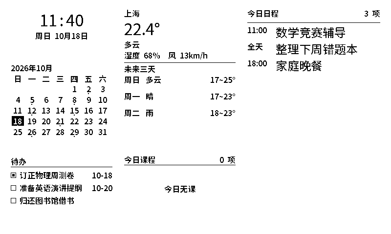

# hardware · 设备端

InkPane 墨窗的设备端固件与硬件资料。

当前状态：**固件 MVP 已实现，等待真机验收**。`hardware/main` 是一个完整的
ESP-IDF v6.0.2 工程，包含屏幕驱动、板级驱动、六模块渲染、Wi-Fi/HTTP、AP 配网与
双周期深睡。真机上的刷新时序、残影与功耗仍需按验收清单逐项确认。

## 硬件平台

墨窗运行在 [微雪 ESP32-S3-ePaper-3.97](https://docs.waveshare.net/ESP32-S3-ePaper-3.97/) 上，
完整的规格表、板载资源图与接口说明见[根目录 README](../README.md#硬件平台)。

- **3.97″ / 800 × 480 电子墨水屏** —— 静态显示零功耗，纸面观感，无背光无频闪
- **ESP32-S3R8 + 16 MB Flash / 8 MB PSRAM** —— 双核 240 MHz，足够跑栅格布局与局部刷新
- **SHTC3 + PCF85063** —— 室内温湿度与走时不需要联网，离网也能显示
- **AXP2101 电源管理 + 3.7 V 锂电池** —— 充电、稳压、屏幕电源与深度休眠一套解决

## 固件能力

| 能力 | 说明 |
| --- | --- |
| 六模块渲染 | 时钟 / 月历 / 天气 / 日程 / 课程 / 待办，按服务端 `layout` 排版，1-bit 中文点阵 |
| 事件总数 | 服务端 `eventTotal/courseTotal/todoTotal` 可大于数组上限（32/16/8）；标题计数与「还有 N 项」用真实总数 |
| ETag / 304 | 内容没变时不重绘；**只有全刷成功后才保存 ETag / 刷新间隔 / 时区**，刷屏失败会清空 ETag 并重试 |
| 双周期休眠 | 每分钟唤醒只局刷时钟；按 `refreshMinutes` 联网拉屏；按键唤醒立即刷新 |
| 深睡局刷 | 深睡时保留 ALDO3 面板供电、控制器不复位；分钟级局刷无黑闪，冷启动/跨天/满 60 次局刷后全刷 |
| RTC | 保留 PCF85063 OS 位；未校时前显示「等待校时」，200 的 `localIso` 或 304 的 `Date` 头校准后清 OS |
| 低电 | 低于 20% 时 200 与 304 都把联网间隔拉长到至少 120 分钟，并显示「低电」 |
| 遥测 | SHTC3 温湿度、AXP2101 电量、RSSI、固件版本、运行时长 |
| AP 配网 | 首次上电或按住 GPIO5 两秒进入；网页填写 Wi-Fi / 服务地址 / 设备令牌 |
| 离线与异常 | 保留上一屏；连续失败显示「离线」，令牌失效显示「令牌无效」，低电显示「低电」 |



> 上图为 host 渲染器用契约示例数据生成的 800 × 480 实际 1-bit 画面，可直接对照设备效果。
> 架构、状态机与排障见 [docs/FIRMWARE.md](docs/FIRMWARE.md)，上真机前请按
> [docs/ACCEPTANCE.md](docs/ACCEPTANCE.md) 逐项验收。

## 构建与烧录

前置：ESP-IDF **v6.0.2**（本机路径 `C:\esp\v6.0.2\esp-idf`，通过
`C:\Espressif\tools\Microsoft.v6.0.2.PowerShell_profile.ps1` 激活）、Python 3.13+、
Ninja + GCC（MSYS2，仅 host 测试需要）。

`build.ps1` 在 `IDF_PATH` / `IDF_TOOLS_PATH` / `ESP_IDF_VERSION` 未配齐时会依次尝试
`INKPANE_IDF_PROFILE`、`-IdfProfile`、`C:\Espressif\tools\Microsoft.v6.0.2.PowerShell_profile.ps1`
和最新的 `Microsoft.v6.*` profile，并在构建前校验 `idf.py --version`。

```powershell
# 构建（默认输出到 %TEMP%\inkpane-build，避免 Windows 260 字符路径限制）
powershell -ExecutionPolicy Bypass -File hardware/tools/build.ps1

# 指定 ESP-IDF 环境 profile（自动探测失败时）
powershell -ExecutionPolicy Bypass -File hardware/tools/build.ps1 `
  -IdfProfile C:\Espressif\tools\Microsoft.v6.0.2.PowerShell_profile.ps1

# 烧录 / 监视
powershell -ExecutionPolicy Bypass -File hardware/tools/build.ps1 -Flash -Port COM5
powershell -ExecutionPolicy Bypass -File hardware/tools/build.ps1 -Monitor -Port COM5

# 产物体积
powershell -ExecutionPolicy Bypass -File hardware/tools/build.ps1 -Size
```

构建日志在 `%TEMP%\inkpane-build\build.log`。**不要把构建目录放在仓库内**：
路径超过 260 字符时 gcc 写 `.obj.d` 会失败，这是 Windows 上的已知坑。

### Host 测试与渲染预览

```powershell
cmake -S hardware/test/host -B "$env:TEMP\inkpane-host" -G Ninja -DCMAKE_C_COMPILER=gcc
cmake --build "$env:TEMP\inkpane-host"
& "$env:TEMP\inkpane-host\inkpane_tests.exe" `
  hardware/main/components/inkpane_ui/fonts/inkpane_fonts.bin hardware/test/fixtures

& "$env:TEMP\inkpane-host\inkpane_preview.exe" `
  hardware/main/components/inkpane_ui/fonts/inkpane_fonts.bin `
  hardware/test/fixtures/screen_200.json screen.bmp
```

`inkpane_preview.exe` 生成的 800 × 480 BMP 就是设备将看到的 1-bit 画面，适合在没有板子时
检查排版、截断与对齐。`hardware/test/fixtures/screen_overflow.json` 用于验证事件/课程/待办
超过渲染上限（32/16/8）时仍按服务端总数显示「还有 N 项」。

## 首次配网

1. 上电（或断电后按住中间按键 GPIO5 两秒再上电），屏幕显示配网说明。
2. 手机/电脑连接热点 `InkPane-XXXXXX`（开放网络，仅配网期间存在）。
3. 浏览器打开 `http://192.168.4.1`，填写 Wi-Fi、服务地址（如 `http://192.168.1.10:4000`）
   与控制台「屏幕与设备 → 添加设备」得到的一次性令牌。
4. 保存后设备自动重启；第一个网络周期内显示真实数据。

服务端需要以 `HOST=0.0.0.0` 启动，设备与电脑在同一网段；完整说明见
[设备端 API 与硬件对接指南](../website/docs/DEVICE-API.md)。

## 目录

```text
hardware/
├── main/                     # ESP-IDF 工程
│   ├── main/                 # app_main + Kconfig
│   ├── components/
│   │   ├── inkpane_board/    # I2C、AXP2101、PCF85063、SHTC3、按键
│   │   ├── inkpane_epd/      # SSD1683 面板驱动（全刷/局刷/休眠）
│   │   ├── inkpane_model/    # JSON/时间/调度（纯 C，host 可测）
│   │   ├── inkpane_ui/       # 1-bit 画布、字库、六模块
│   │   ├── inkpane_net/      # Wi-Fi、HTTP、NVS 配置
│   │   └── inkpane_prov/     # AP + DNS + 配网网页
│   ├── partitions.csv
│   └── sdkconfig.defaults
├── tools/
│   ├── build.ps1             # 构建/烧录/监视
│   └── genfont.py            # 从 Noto Sans SC 生成点阵字库
├── test/
│   ├── host/                 # host 单测（Ninja + GCC）+ BMP 预览
│   └── fixtures/             # 屏幕数据样例
└── docs/FIRMWARE.md          # 架构、状态机、排障
```

## 开发环境

- ESP-IDF **v6.0.2**，target `esp32s3`（本仓库已用 `C:\esp\v6.0.2\esp-idf` 验证构建）
- 上手参考：[ESP-IDF 开发教程](https://docs.waveshare.net/ESP32-S3-ePaper-3.97/ESP-IDF) ·
  [Arduino 开发教程](https://docs.waveshare.net/ESP32-S3-ePaper-3.97/Arduino) ·
  [Flash 固件烧录](https://docs.waveshare.net/ESP32-S3-ePaper-3.97/Firmware-Flashing)
- 原理图、规格书与示例代码：[相关资料](https://docs.waveshare.net/ESP32-S3-ePaper-3.97/Resources-And-Documents)
