# InkPane 墨窗 · 控制台

InkPane 墨窗的桌面端管理后台。日程、课程、待办、天气与桌面墨水屏的窗格布局都在这里整理；
设备端通过一套稳定的 HTTP 契约拉取屏幕数据，不依赖云服务，也不需要账号。

前端 React 18 + TypeScript + Vite，后端 Express + `node:sqlite`，数据全部保存在本机。

```text
website/
├── server/          # 后端：Express + node:sqlite，REST API
├── web/             # 前端：React + TypeScript + Vite
├── docs/            # 架构说明、REST API、设备对接文档、界面截图
└── scripts/         # 工程脚本
```

---

## 快速开始

环境要求：**Node.js >= 22.5**（需要内置的 `node:sqlite`）。整个项目零原生依赖，
不需要 node-gyp 或 Visual Studio Build Tools。

```bash
cd website
npm install          # 安装前后端全部依赖（npm workspaces）
npm run dev          # 同时启动 API（:4000）与前端（:5173）
```

打开 <http://localhost:5173> 即可。首次启动会自动建库、执行迁移并写入一批演示日程，
因此界面不会是空的。

其他常用命令：

| 命令 | 作用 |
| --- | --- |
| `npm run dev` | 并行启动前后端（开发模式，前端热更新） |
| `npm run dev:api` | 只启动后端 |
| `npm run dev:web` | 只启动前端 |
| `npm run lint` | ESLint（含 react-hooks 规则，可拦住 Hook 顺序类崩溃） |
| `npm run typecheck` | 前后端 TypeScript 全量类型检查 |
| `npm test` | 前后端单元测试与接口集成测试 |
| `npm run verify` | lint + 类型检查 + 测试 + 生产构建（提交前跑一遍） |
| `npm run build` | 构建前端产物与后端 JS |
| `npm start` | 以生产模式启动后端 |
| `npm run clean` | 清理构建产物（不会动 `data/` 里的数据库） |
| `npm run format` | Prettier 格式化 |

### 数据库管理

```bash
cd server
npm run db:migrate   # 只执行迁移
npm run db:seed      # 写入演示数据（库非空时跳过）
npm run db:reset     # 删库重建并重新写入演示数据
```

数据库文件默认位于 `website/data/inkpane.sqlite`。所有运行期配置见
`server/.env.example`，复制为 `server/.env` 后按需修改。

### 生产部署（可选）

前后端可以分开放，也可以同进程部署：

```bash
npm run build
# server/.env 中设置 SERVE_STATIC=true，然后：
npm start            # 后端同时托管 web/dist，访问 http://127.0.0.1:4000
```

---

## 功能

**总览**

- 今日大时钟、日程 / 课程 / 待办数量与已排时长
- 天气卡片与未来三天气温，设备在线状态与电量
- 直接渲染设备端 `DeviceScreenPayload` 的缩略预览，所见即屏幕所得

**日历**

- 月视图：6 周网格，跨天全天事件按天展开，超出显示条数时折叠为「还有 N 项」
- 周视图 / 日视图：24 小时时间轴，重叠日程自动并排分列
- 列表视图：连续 30 天按天分组，适合规划与回顾
- 拖拽改期（不依赖任何拖拽库）：空白处拖出新建、拖事件块改期、拉底边调时长，15 分钟吸附；
  `Esc` 放弃本次拖拽，松手前不写库
- 重复日程：每天 / 每周 / 每月 / 每年，可改单次、改此后所有或拆分序列
- 分类、标签、搜索筛选、到点提醒

**待办**

- 快速录入（回车添加）、优先级、今天到期、完成即勾去
- 进行中 / 今天到期 / 已完成 / 全部四种筛选；勾选使用乐观更新，不等接口返回
- 概览统计：进行中、今天到期、已逾期、已完成
- 设备端只读取未完成的前 8 条，按优先级与截止日期排序

**天气**

- 后端向 Open-Meteo 拉取并缓存 15 分钟，失败回退到最近一次成功的数据，不返回 500
- 当前实况、体感、湿度、风速、今日降水概率与未来三天
- 城市搜索（Open-Meteo geocoding）自动填经纬度，也可手动填写
- 读取设备 SHTC3 上报的室内温湿度，与室外天气并排展示

**屏幕与设备**

- 800 × 480 墨水屏实时预览，按模块坐标绝对定位、整体等比缩放；只使用黑 / 白 / 灰度
- 四套布局预设（均衡 / 日程优先 / 天气优先 / 极简）+ 六个模块独立开关
- 刷新间隔 5–720 分钟；保存后设备下次拉取即生效
- 设备令牌：查看、复制、轮换（旧令牌立即失效）；设备拉取地址一键复制
- 遥测状态：最近上报、电量、信号、固件版本、室内温湿度
- 接入步骤与「硬件对接文档」直达链接

**课程同步**

- 从 `ws8.yucai.sh.cn` 读取课表并生成每周重复的日程
- 支持测试连接 / 预览课表 / 立即导入 / 按已保存配置同步，可开启自动定时同步
- 每节课起止时间可逐条配置；周五可使用独立时间表
- 幂等：重复同步只更新不重复，课表里消失的课会被自动删除

> ⚠️ 学校系统本身是 HTTP 明文站点，账号密码在到达校方服务器时不受传输加密保护，
> 这是校方系统的限制。InkPane 保证的是本机侧加密保存与不回传明文。

**其他**

- 深色 / 浅色 / 跟随系统三种主题，首屏渲染前即生效，不会白屏闪烁
- 键盘操作：`T` 今天、`M/W/D` 切换视图、`A` 列表、`←/→` 翻页、`N` 新建、`/` 搜索、`Esc` 关闭面板
- 响应式布局：桌面端常驻侧栏，移动端改为抽屉 + 底部标签栏
- 加载骨架屏、空状态、错误状态与失败重试齐全

---

## 界面

| 总览 | 待办 |
| --- | --- |
| 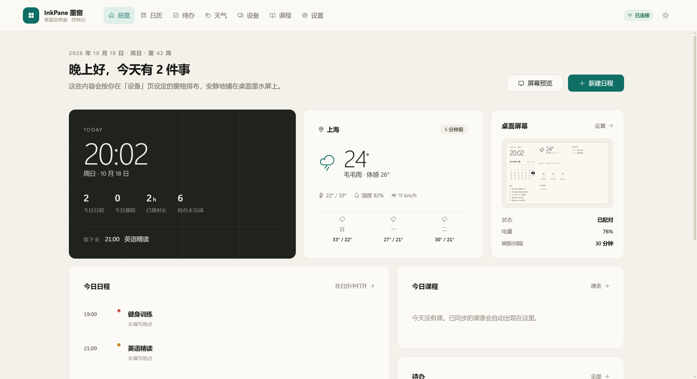 | 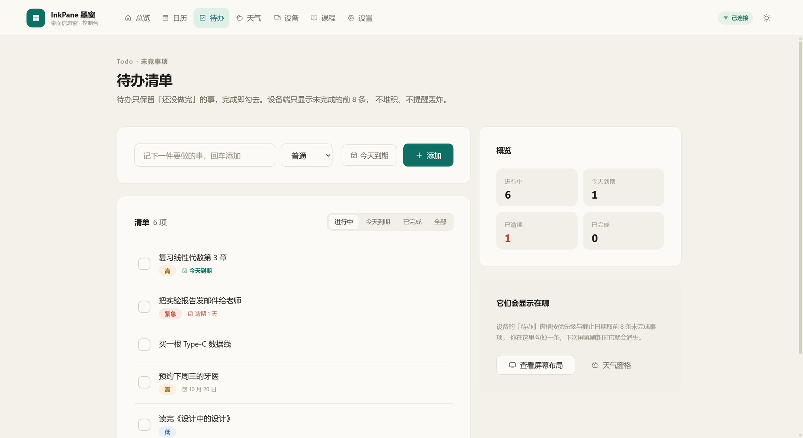 |

| 天气 | 屏幕与设备 |
| --- | --- |
| 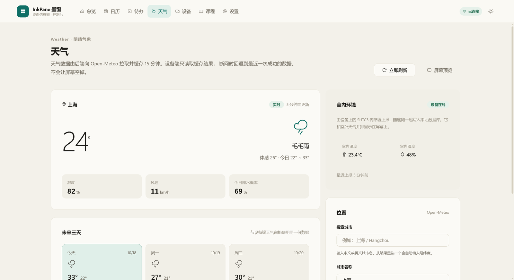 | 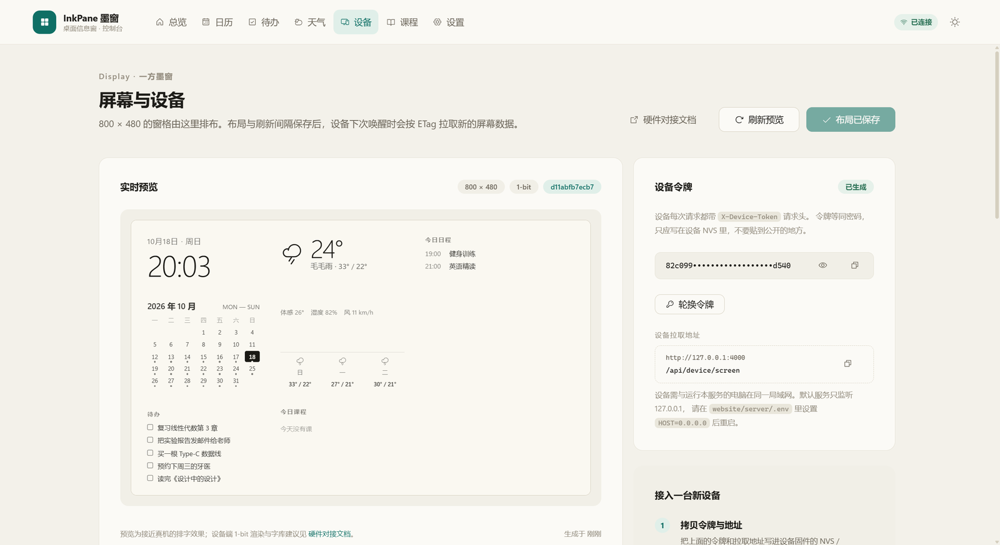 |

| 月视图 | 列表视图 |
| --- | --- |
| 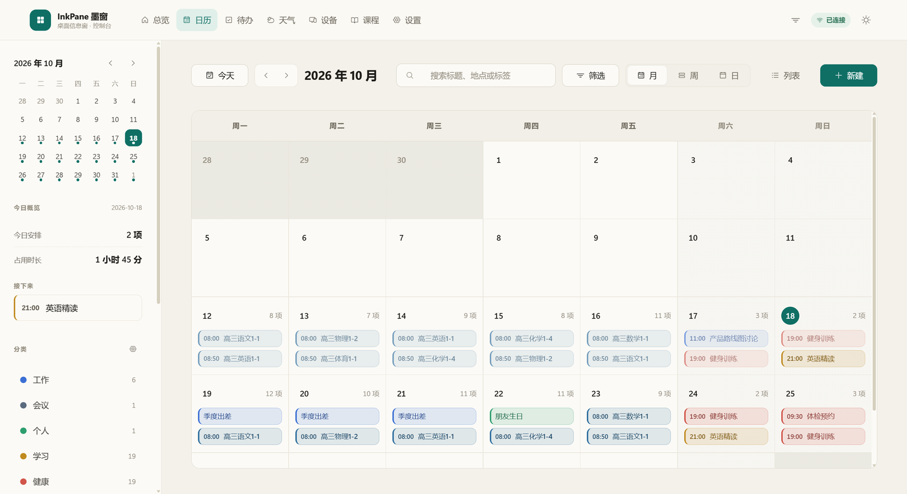 | 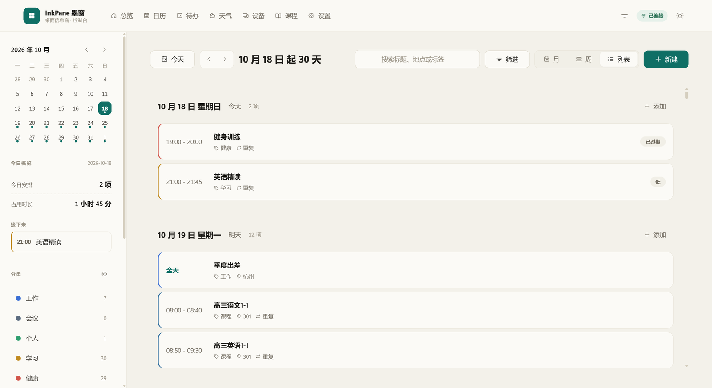 |

| 周视图 | 日视图 |
| --- | --- |
| 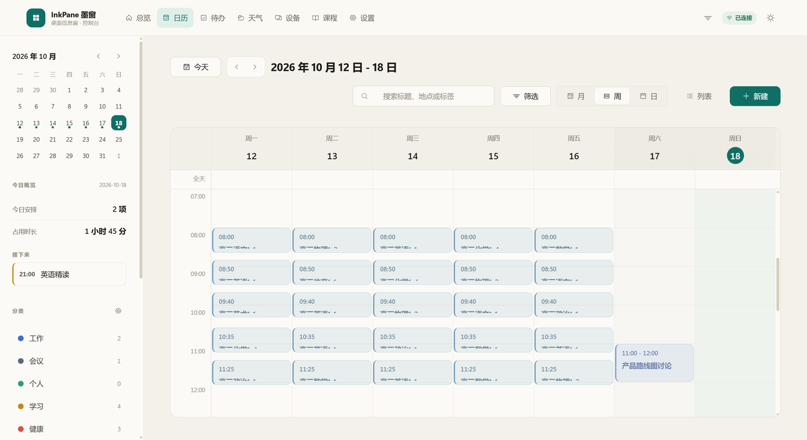 | 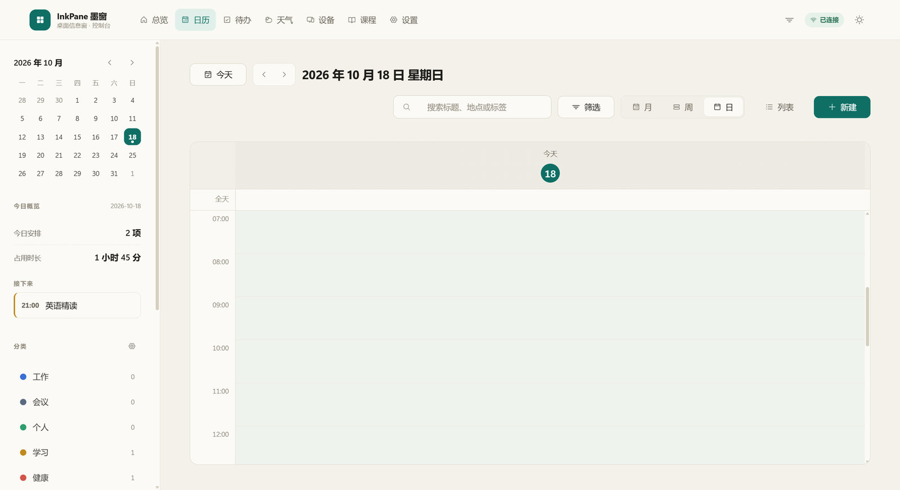 |

| 新建日程 | 日程详情 |
| --- | --- |
| 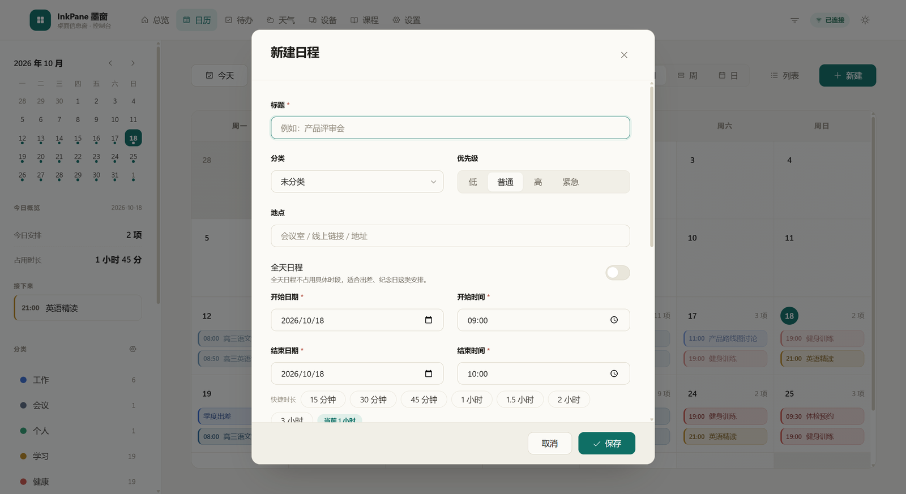 | 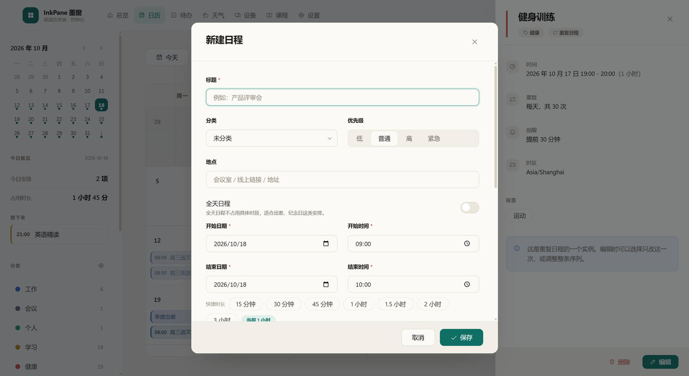 |

| 课程同步 | 设置 |
| --- | --- |
| 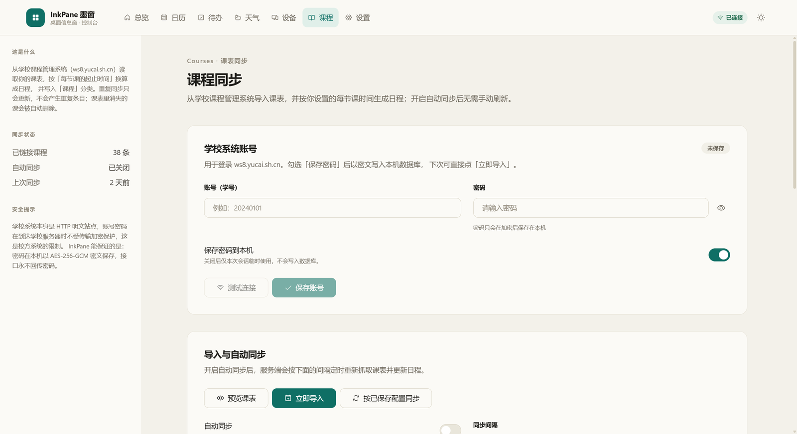 | 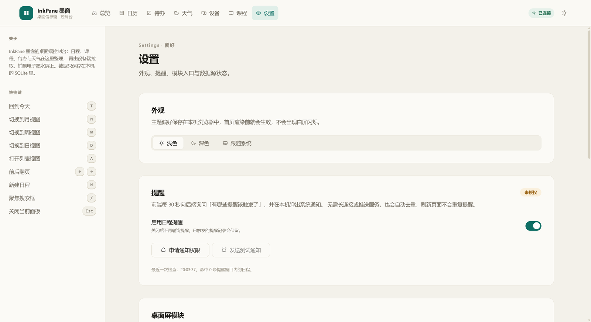 |

| 深色月视图 | 深色设备页 |
| --- | --- |
| 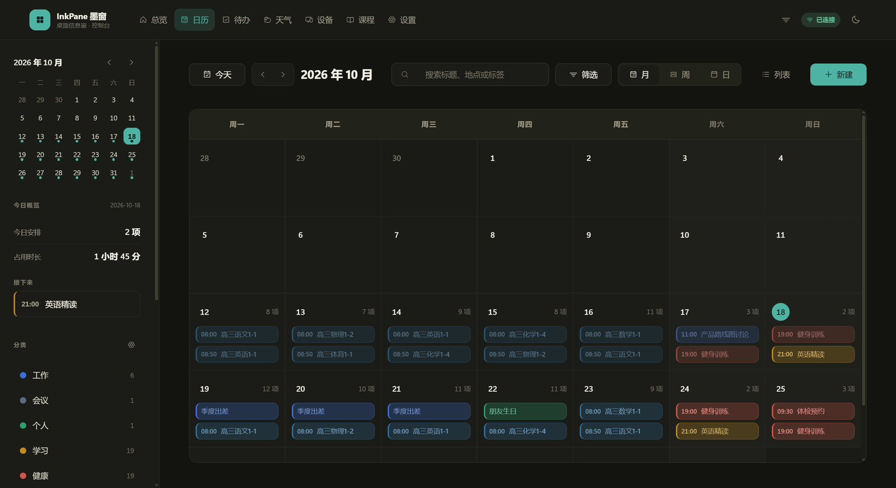 | 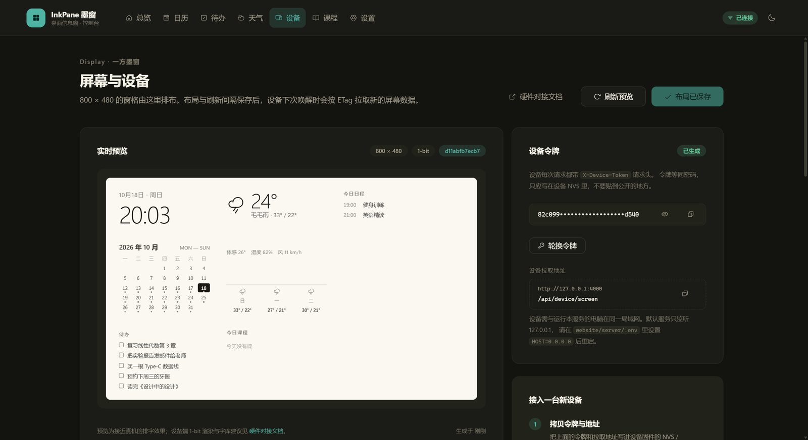 |

---

## 设备对接

设备端需要的全部契约（鉴权、屏幕数据、ETag / 304、遥测、布局、渲染规范、ESP-IDF 示例）
都在 **[DEVICE-API.md](docs/DEVICE-API.md)**，这里只列最常用的几条：

| 接口 | 鉴权 | 说明 |
| --- | --- | --- |
| `GET /api/device/screen` | `X-Device-Token` | 屏幕数据；支持 `If-None-Match`，未变化返回 304 |
| `POST /api/device/telemetry` | `X-Device-Token` | 上报温湿度、电量、信号与固件版本 |
| `GET /api/display` / `PUT /api/display` | 控制台 | 窗格布局与刷新间隔 |
| `GET /api/device/token` / `POST /api/device/token` | 控制台 | 获取 / 轮换设备令牌 |

设备令牌在控制台「设备」页获取；默认服务只监听 `127.0.0.1`，设备接入时把
`server/.env` 里的 `HOST` 改为 `0.0.0.0` 再重启。

---

## 工程要点

**一套响应信封**：所有接口成功时返回 `{ data, meta? }`，失败时返回
`{ error: { code, message, details?, requestId } }`；`requestId` 同时写入响应头
`X-Request-Id`，前端报错时可直接对照服务端日志。

**设备端低功耗友好**：`/api/device/screen` 用数据内容的 sha1 生成 ETag，并支持
`If-None-Match` → 304；ETag 不包含 `generatedAt` 与 `now.time`，因此时钟由设备本地
RTC 走时，不会因为分钟数变化而触发整屏重绘。

**前后端分离但开发期无跨域烦恼**：Vite 把 `/api` 代理到 `127.0.0.1:4000`，
前端代码里只写 `/api`，部署时可以指向任意后端地址（`VITE_API_BASE`）。

**零原生依赖**：SQLite 使用 Node 内置的 `node:sqlite`，`npm install` 不需要编译。
所有 SQL 都收敛在 `server/src/db/` 与各模块的 `repository` 中。

**可注入的天气 provider**：天气服务在测试里注入 fetch，因此缓存、TTL、失败回退、
城市搜索降级都能在不访问真实站点的前提下完整测试。

**时区安全**：定时事件存储为 ISO-8601 UTC 瞬间，全天事件存储为纯日期串 `YYYY-MM-DD`；
设备屏幕的「今天 / 本周 / 月历」按 `display.timezone`（默认 `Asia/Shanghai`）计算。

**类型贯穿全链路**：请求体、查询参数、响应结构都由 Zod / TypeScript 约束，
前端 `web/src/types.ts` 与后端 DTO 一一对应，接口改动会在类型检查阶段暴露。

**测试**：后端 159 项（时区、重复规则、学校系统客户端、课表解析、REST 接口集成、
待办、天气、布局、设备令牌 / ETag / 304 与错误码），前端 58 项
（日期工具、颜色对比度、日历布局算法、表单校验、月视图组件渲染）。

**静态检查三层**：ESLint 负责 Hook 顺序与未使用变量这类类型系统看不到的问题，
`tsc` 负责全量类型，Vitest 负责行为。三者都在 `npm run verify` 里。

---

## 设计说明

这是一套「纸本 + 留白」的管理后台：视觉呼应电子墨水屏，而不是做成高密度 SaaS。

- **暖白纸面**：底色 `#f3f1ea`、卡片 `#fbfaf6`，边线是极浅的纸纤维色；暗色主题使用暖炭黑
- **单一强调色**：深青 `#0f6f65`（暗色 `#4fb3a3`），全站只出现这一种强调色
- **放大一档的尺度**：正文 15px、行高 1.62，区块间距 26–36px，卡片内边距 36px；
  `--space` 从 4px 到 104px 共十档
- **一套圆角**：控件 10px、卡片 16px、标签胶囊 999px
- **总览是「设备那一屏」的放大**：数据直接来自 `/api/display/screen`，缩略预览与设备端同源
- **墨水屏预览**：模块按 4px 网格绝对定位，整体等比缩放；1-bit 观感，不引入彩色
- **克制的动效**：只用于状态切换与拖拽反馈，并完整支持 `prefers-reduced-motion`
- **无 emoji、不手写 SVG**：图标统一来自 Phosphor 图标族，线重与尺寸档位在
  `components/ui/icon.tsx` 集中固定

---

## 文档

- [架构说明](docs/ARCHITECTURE.md)：分层设计、数据流、重复日程引擎与关键取舍
- [REST API](docs/API.md)：完整的接口说明、参数、示例与错误码
- [设备端 API 与硬件对接](docs/DEVICE-API.md)：鉴权、屏幕契约、渲染规范、低功耗、ESP-IDF 示例
