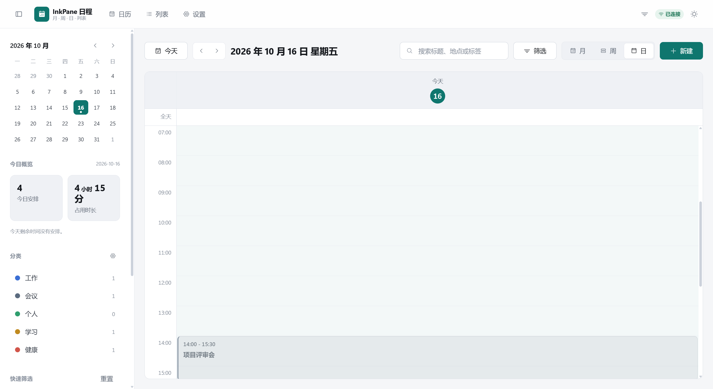
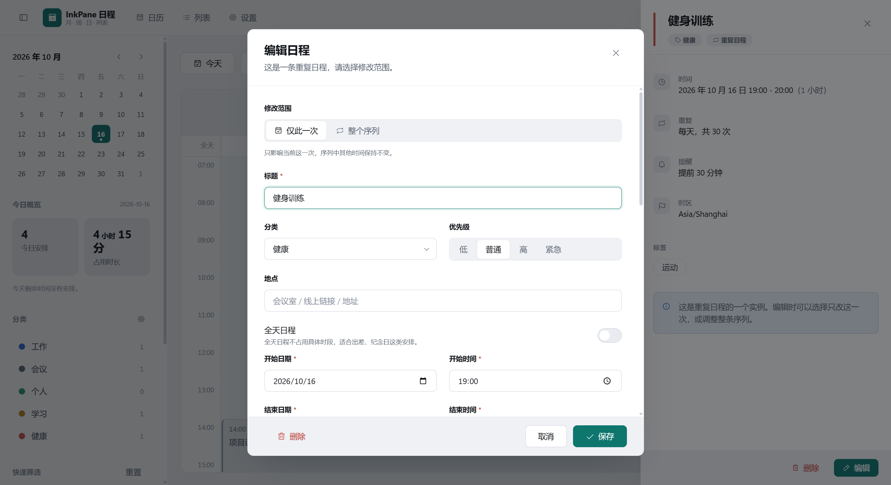
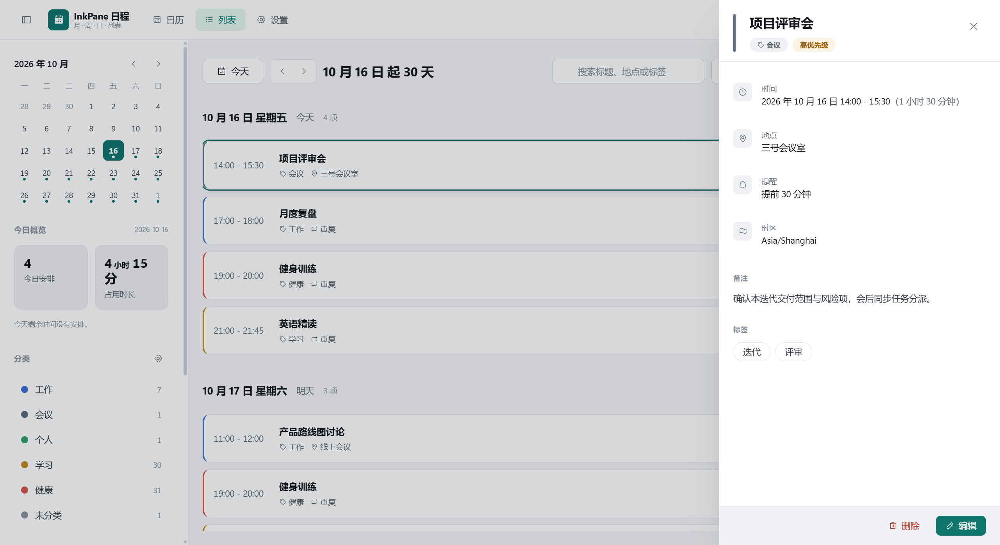
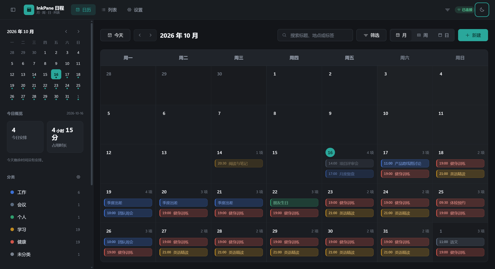
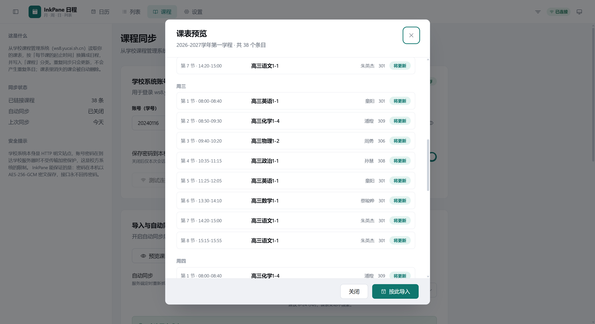
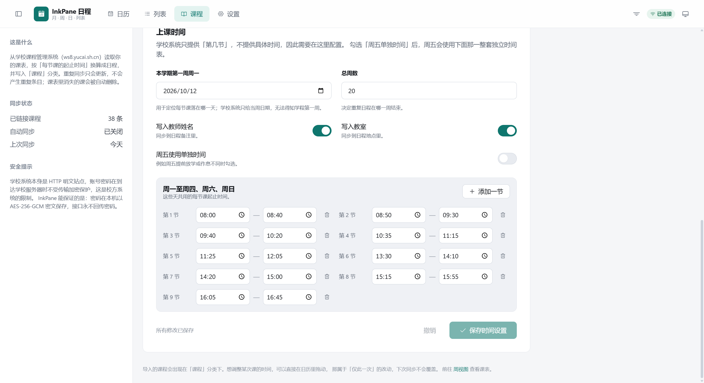
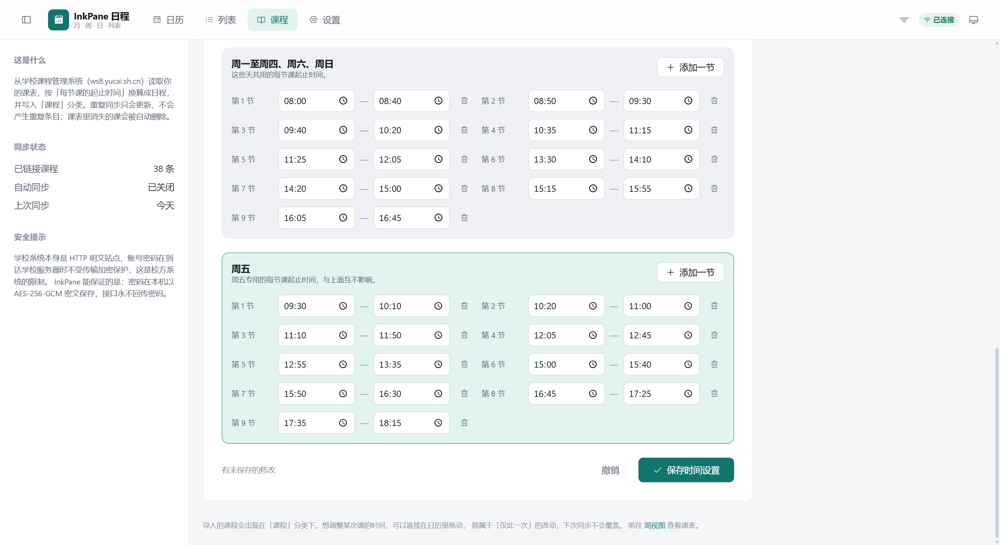
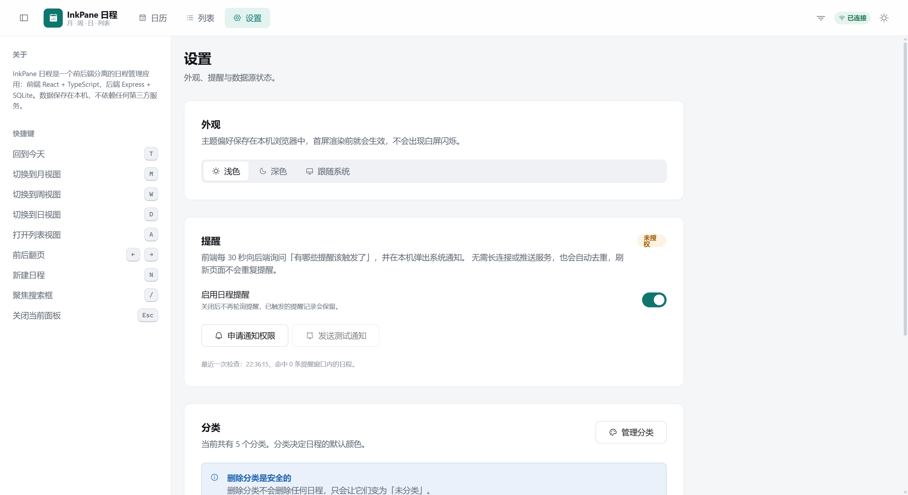

# InkPane 日程

一个前后端分离的日程管理应用。前端 React 18 + TypeScript + Vite，后端 Express + SQLite。
数据保存在本机，不依赖任何第三方服务，也不需要云账号。

```
website/
├── server/          # 后端：Express + node:sqlite
├── web/             # 前端：React + TypeScript + Vite
├── docs/            # 架构说明、API 文档、界面截图
└── scripts/         # 工程脚本
```

---

## 快速开始

环境要求：**Node.js >= 22.5**（需要内置的 `node:sqlite`）。整个项目零原生依赖，
不需要 node-gyp 或 Visual Studio Build Tools。

```bash
cd website
npm install          # 安装前后端全部依赖（npm workspaces）
npm run dev          # 同时启动 API（:4000）与前端（:5173）
```

打开 <http://localhost:5173> 即可。首次启动会自动建库、执行迁移并写入一批演示日程，
因此界面不会是空的。

其他常用命令：

| 命令 | 作用 |
| --- | --- |
| `npm run dev` | 并行启动前后端（开发模式，前端热更新） |
| `npm run dev:api` | 只启动后端 |
| `npm run dev:web` | 只启动前端 |
| `npm run lint` | ESLint（含 react-hooks 规则，可拦住 Hook 顺序类崩溃） |
| `npm run typecheck` | 前后端 TypeScript 全量类型检查 |
| `npm test` | 前后端单元测试与接口集成测试 |
| `npm run verify` | lint + 类型检查 + 测试 + 生产构建（提交前跑一遍） |
| `npm run build` | 构建前端产物与后端 JS |
| `npm start` | 以生产模式启动后端 |
| `npm run clean` | 清理构建产物（不会动 `data/` 里的数据库） |
| `npm run format` | Prettier 格式化 |

### 数据库管理

```bash
cd server
npm run db:migrate   # 只执行迁移
npm run db:seed      # 写入演示数据（库非空时跳过）
npm run db:reset     # 删库重建并重新写入演示数据
```

数据库文件默认位于 `website/data/inkpane.sqlite`。所有运行期配置见
`server/.env.example`，复制为 `server/.env` 后按需修改。

### 生产部署（可选）

前后端可以分开放，也可以同进程部署：

```bash
npm run build
# server/.env 中设置 SERVE_STATIC=true，然后：
npm start            # 后端同时托管 web/dist，访问 http://127.0.0.1:4000
```

---

## 功能

**四种视图**

- 月视图：6 周网格，跨天全天事件按天展开，超出显示条数时折叠为「还有 N 项」
- 周视图 / 日视图：24 小时时间轴，重叠日程自动并排分列
- 列表视图：连续 30 天按天分组，适合规划与回顾

**拖拽改期（不依赖任何拖拽库）**

- 时间轴空白处按下拖动 = 新建日程，15 分钟吸附，实时显示时间预览
- 拖动事件块 = 改期，可跨天跨列
- 拖动事件块底边 = 调整时长
- 月视图拖动 = 换日期，保持原有具体时间
- 拖拽重复日程松手后弹出范围选择：仅此一次 / 此后所有 / 整个序列
- `Esc` 放弃本次拖拽，松手前不写库，不会产生中间态脏数据

**重复日程**

支持每天 / 每周 / 每月 / 每年，可设置间隔、按周几重复、按次数或按日期结束。
可以单独修改或取消某一次实例，也可以把序列从某次开始一分为二，前后两段各自独立维护。

**分类与标签**

分类带颜色，事件可用分类色或自定义颜色；标签用于跨分类检索。删除分类不会删除任何日程，
只会把它们变为「未分类」。

**搜索与筛选**

关键词匹配标题、地点、备注与标签；可按分类、优先级、状态、标签筛选，并可选是否显示已取消的日程。
筛选条件会持久化到本机，刷新后保持。

**提醒**

每 30 秒轮询一次「有哪些提醒该触发了」，通过系统通知弹窗；未授权时自动退化为页面内提示。
已触发的提醒记录在 localStorage 中，刷新页面不会重复提醒。

**课程同步（对接学校课程管理系统）**

从 `ws8.yucai.sh.cn` 读取课表并生成每周重复的日程：

- 输入学号与密码，可选**保存密码**（以 AES-256-GCM 密文写在本机，接口永不回传明文）
- 支持**测试连接** / **预览课表** / **立即导入** / **按已保存配置同步**
- **自动同步**：开启后服务端按间隔定时抓取更新，无需打开页面
- **每节课起止时间**可逐条配置（学校系统只给「第几节」，不给时间）；
  勾选「**周五使用单独时间**」后周五会用一整套独立时间表
- 幂等：重复同步只更新不重复；课表里消失的课会被自动删除；
  手动拖动某次课属于「仅此一次」，不会被同步覆盖

> ⚠️ 学校系统本身是 HTTP 明文站点，账号密码在到达校方服务器时不受传输加密保护，
> 这是校方系统的限制。InkPane 能保证的是本机侧加密保存与不回传明文。

**其他**

- 深色 / 浅色 / 跟随系统三种主题，首屏渲染前即生效，不会白屏闪烁
- 完整键盘操作：`T` 今天、`M/W/D` 切换视图、`A` 列表、`←/→` 翻页、`N` 新建、`/` 搜索、`Esc` 关闭面板
- 响应式布局：桌面端常驻侧栏，移动端改为抽屉 + 底部标签栏，弹窗改为底部抽屉形态
- 加载骨架屏、空状态、错误状态与失败重试齐全

---

## 界面

| 月视图（浅色） | 周视图（浅色） |
| --- | --- |
|  |  |

| 日视图 | 列表视图 |
| --- | --- |
|  |  |

| 新建日程 | 编辑重复日程 |
| --- | --- |
|  |  |

| 日程详情 | 月视图（深色） |
| --- | --- |
|  |  |

| 课程同步 | 课表预览 |
| --- | --- |
|  |  |

| 每节课时间配置 | 周五单独时间 |
| --- | --- |
|  |  |

| 设置 | |
| --- | --- |
|  | |

---

## 工程要点

**前后端分离但开发期无跨域烦恼**：Vite 把 `/api` 代理到 `127.0.0.1:4000`，
前端代码里只写 `/api`，部署时可以指向任意后端地址（`VITE_API_BASE`）。

**零原生依赖**：SQLite 使用 Node 内置的 `node:sqlite`，`npm install` 不需要编译，
换台机器不会因为缺少构建工具而失败。所有 SQL 都收敛在 `server/src/db/` 与各模块的
`repository` 中，要换成 `better-sqlite3` 只需改一个文件。

**时区安全**：定时事件存储为 ISO-8601 UTC 瞬间，全天事件存储为纯日期串 `YYYY-MM-DD`。
重复日程按事件自身时区的「墙上时间」展开，因此跨夏令时不会整体漂移一小时。
这一点有专门的单元测试覆盖。

**类型贯穿全链路**：请求体、查询参数、响应结构都由 Zod / TypeScript 约束，
前端 `web/src/types.ts` 与后端 DTO 一一对应，接口改动会在类型检查阶段暴露。

**测试**：后端 113 项（时区工具、重复规则引擎、学校系统客户端、课表解析器、REST 接口集成），
前端 58 项（日期工具、颜色对比度、日历布局算法、表单校验、月视图组件渲染）。

其中学校系统客户端用一个本地模拟服务测试：它同样每次下发随机密钥、只接受 AES-128-CBC/PKCS7
密文、业务接口只接受 POST —— 因此登录链路可以在不访问真实站点的前提下被完整锁住。

**静态检查三层**：ESLint 负责 Hook 顺序与未使用变量这类类型系统看不到的问题，
`tsc` 负责全量类型，Vitest 负责行为。三者都在 `npm run verify` 里。

---

## 文档

- [架构说明](docs/ARCHITECTURE.md)：分层设计、数据流、重复日程引擎与关键取舍
- [API 文档](docs/API.md)：完整的 REST 接口说明、参数与示例

---

## 设计说明

这是一个高密度数据型工具界面，不是营销落地页，因此视觉决策围绕「信息密度 + 可预测的网格」。
密度取向是**舒适优先**：宁可让月视图滚动或折叠，也不把内容压进格子里。

- **单一强调色**：深青 `#0f766e`（暗色主题为 `#2aa79b`），全站只出现这一种强调色，
  分类色只作为数据色使用，不参与界面装饰
- **一套圆角规则**：控件 8px、容器 12px、标签胶囊 999px，全站一致
- **偏宽松的尺度**：正文 15px（原 14px），控件高 42px，每小时时间轴 72px，
  间距走 4/8/12/16/24/32/44/64 的节奏
- **月视图自适应**：实测单元格高度决定显示几条事件；当「还有 N 项」按钮会挤掉一条事件时，
  改为不渲染按钮，用日期右侧的「N 项」计数 + 点击当天进入日视图表达还有更多。
  同时按视口高度分档降低行高，尽量让整月一屏看完
- **等宽数字**：所有时间与数字使用 `tabular-nums`，时间列不会左右跳动
- **对比度自动校验**：全天事件用分类色实底填充，文字色由 `readableInk()` 按 WCAG
  相对亮度动态挑选，任何用户自选颜色都能保证可读
- **克制的动效**：只用于状态切换与拖拽反馈，并完整支持 `prefers-reduced-motion`
- **无 emoji、不手写 SVG**：图标统一来自 Phosphor 图标族，线重与尺寸档位在
  `components/ui/icon.tsx` 集中固定
